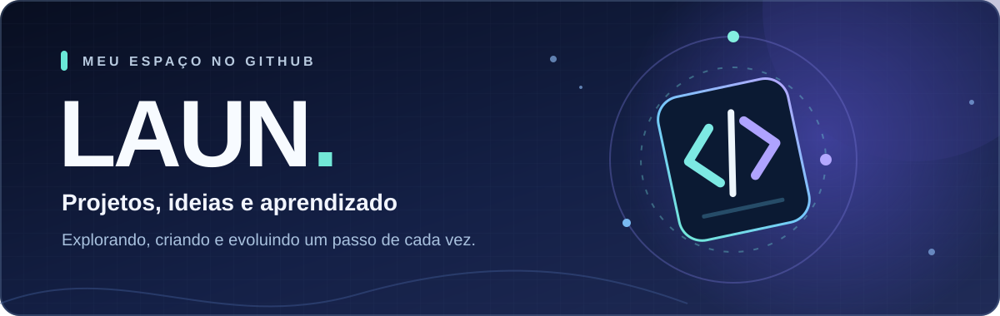

  

   

  ### Olá! Eu sou o Laun 👋

  Bem-vindo ao meu espaço no GitHub. 🚀

  Aprendendo, criando e compartilhando minha evolução.

---

### ✨ Sobre mim

Gosto de explorar novas ideias e usar este espaço para organizar meus estudos, experiências e projetos.

Por aqui você vai encontrar iniciativas que refletem meu aprendizado e meu interesse por tecnologia.

### 🧩 O que você encontra por aqui

- 💡 **Projetos pessoais** — ideias que coloco em prática.
- 📚 **Aprendizado** — conteúdos e desafios que me ajudam a evoluir.
- 🛠️ **Experimentação** — diferentes maneiras de resolver problemas.

### 🧰 Tecnologias

*Esta seção será personalizada com as tecnologias que eu realmente utilizo.*

<!-- Quando o Laun confirmar suas habilidades, substitua a frase acima por ícones e uma tabela de tecnologias. -->

### 📌 Projetos

Veja os repositórios públicos logo abaixo no perfil para conhecer o que venho desenvolvendo.

---

  Feito com curiosidade, dedicação e vontade de aprender. ✦

